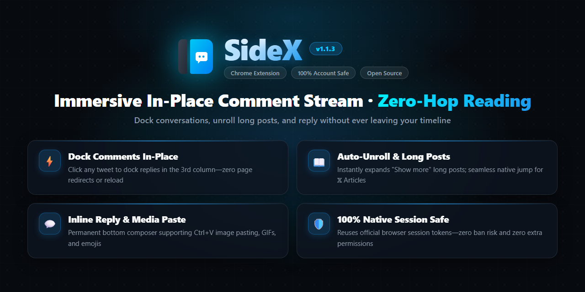
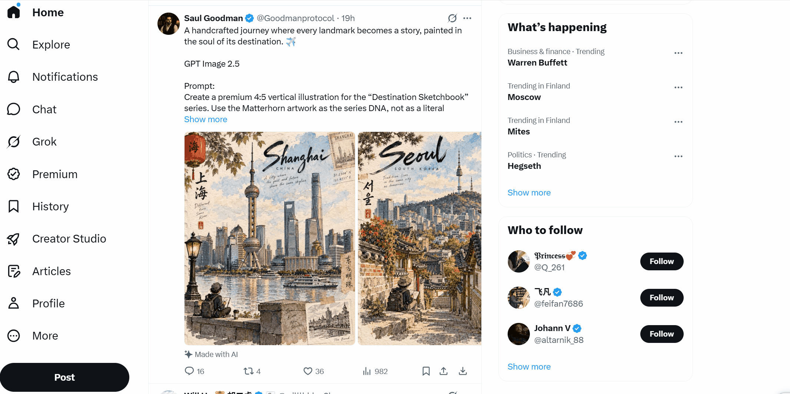

<div align="center">
  <a href="https://github.com/UncleK/SideX">
    
  </a>

  <p>
    <a href="README_CN.md">🇨🇳 简体中文</a> •
    <a href="#features">Features</a> •
    <a href="#installation">Installation</a> •
    <a href="#shortcuts">Shortcuts</a> •
    <a href="#license">License</a>
  </p>

  <p>
    <a href="https://chromewebstore.google.com/detail/ccbkagemmobenjoioicemekhjbggmpde">
      
    </a>
    
    
    
    
  </p>

  <br />
  <a href="demo/demo.mp4">
    
  </a>
  <p><em>🎬 Click preview to open the HD demo video (<a href="demo/demo.mp4">demo.mp4 · 947KB</a>)</em></p>
  <br />
</div>

---

## 📖 Overview

**SideX** transforms how you read X (Twitter) on the web. **Click any tweet to auto-load comments on the right and unroll long posts in-place**—experience seamless, uninterrupted reading with zero page hops. Never lose your timeline scroll position again.

---

## ✨ Features

* 🚀 **In-Place Drawer**: Click any tweet to dock its replies directly in the 3rd column—zero page redirects or reload.
* 📖 **Auto-Unroll Long Posts**: Automatically expands "Show more" on focal posts.
* 🧵 **Conversation Tree & Drill-down**: Reconstructs nested replies with clean thread lines; configurable sub-reply previews (1, 2, 3, 5) with zero-jump smooth in-place expansion.
* 💬 **Quick replies and official dialogs**: The compact quick toolbar has seven entries: images, GIFs, polls, emoji, scheduling, location and content disclosure (flag). Send text, emoji and up to four JPG/PNG/WebP images directly. Advanced tools open X's actual dialogs above the sidebar. In Official mode, clicking a comment's reply icon opens the official reply dialog in the current page without another browser window.
* ✍️ **Reply draft protection**: While editing a quick reply, outside clicks, Esc, selecting another post and X navigation keep the current conversation open. Image-only replies and quick tools also start protection. The close button stays available; confirmed sends release protection, while failed sends retain it.
* 🔄 **Native interactions first**: Reuse native like, bookmark, and menu controls when the same post is rendered on the page; other comments use X session requests.
* 🌐 **Translation options**: Use X official translation by default, choose Google, or hide SideX translation controls and use your existing translator's selection/page translation.
* 👤 **Profile hover cards**: Reuse the actual X card next to the sidebar when a matching native profile link exists; otherwise show a fallback with biography, relationship counts, and followers you know.
* 🎨 **Adaptive Themes & Resizable**: Matches X's Light, Dim, and Dark themes. Drag the right edge to adjust sidebar width.
* 🛡️ **Runs in your browser**: Reuses your X session without a SideX relay server. When Google translation is selected, post text is sent directly to Google.

---

## 📦 Installation

Compatible with Chrome, Edge, Brave, Arc, and other Chromium browsers:

### Method 1: Chrome Web Store (Recommended, One-Click)
👉 **[Install from Chrome Web Store](https://chromewebstore.google.com/detail/ccbkagemmobenjoioicemekhjbggmpde)** with seamless automatic updates!

### Method 2: ZIP Package (100% Reliable & Offline)
1. Download the latest published **`SideX-v*.zip`** from [Releases](https://github.com/UncleK/SideX/releases) and extract it.
2. Open `chrome://extensions/` (or `edge://extensions/`), enable **"Developer mode"** in the top-right corner.
3. Click **"Load unpacked"** and select the extracted folder.

### Method 3: Clone via Git (For Developers)
```bash
git clone https://github.com/UncleK/SideX.git
```
Then click **"Load unpacked"** and select the cloned `SideX` folder.

5. Open [x.com](https://x.com) or [twitter.com](https://twitter.com) and click any tweet to start reading!

---

## ⌨️ Shortcuts

| Shortcut / Action | Description |
| :--- | :--- |
| **Click Tweet body** | Open comments in place; send or explicitly close a protected reply before switching posts |
| **ESC** | Close the current overlay; keep the comments drawer open while reply protection is active |
| **Click outside drawer** | Close comments drawer when reply protection is inactive |
| **Drawer close button** | Explicitly close the drawer and end reply protection; retain the draft on the current page |
| **Drag right edge** | Resize drawer width (auto-saved) |
| **Double-click handle** | Reset drawer to default width |
| **Ctrl + V** | Paste clipboard image directly into reply box |
| **Ctrl + Enter** | Send reply |

---

## ⚠️ Disclaimer

SideX is an independent open-source productivity extension and is **not affiliated with, endorsed by, or associated with X Corp. or Twitter**.

---

## Development and verification

The committed source and `vendor/twitter-text.js` need no build for normal edits. Run `npm run build:text` when updating the text library; this also generates bundled license notices. Reload SideX in `chrome://extensions` after editing, then refresh X.

```bash
npm ci --ignore-scripts
npm test
```

Tests use synthetic X responses and DOM fixtures without performing real account actions. They cover profile parsing, translation requests, long-text chunking, native controls, rollback, retained reading state, scroll reset, and stale responses. X internals and third-party translation extensions may change. Without a matching native profile link, SideX renders a fallback with a full-profile link rather than simulating Grok's Profile Summary button; comments without native nodes are still rendered by SideX.

Version 1.1.21 prevents ordinary post-body and blank-area clicks from reaching X's navigation handler while a quick reply is protected. The current conversation and draft stay in place, with a prompt to send or close the comments panel before switching. Confirmed sends or manual close restore normal drawer switching. Timestamps, photos, quoted posts and native action buttons keep their existing behavior. Validation includes 79 local regression cases, including simulated X navigation handlers for this conflict.

Version 1.1.20 fixes the quick reply button staying on "Replying..." after a request finishes. Success, failure and unconfirmed responses restore the idle label using the current language. Failed or unconfirmed sends retain the draft. Validation includes 76 local regression cases covering consecutive replies, failure and retry, language changes and reply-mode changes during a pending send.

Version 1.1.19 protects quick replies after focus leaves the composer, including image-only drafts and native quick tools. Protection follows the active draft, so an older send cannot unlock a newer reply. It also fixes sent text returning after reply-mode changes during a pending send, allows matching comments to finish loading while a reply is pinned, and preserves the conversation and draft across photo changes and native overlays. Editing beside a photo keeps an explicit close button available alongside the native collapse control. Validation includes 74 local regression cases, with 11 added during review of [PR #1](https://github.com/UncleK/SideX/pull/1).

Version 1.1.18 adds a Photo comments setting, defaulting to SideX. SideX replaces only the native photo viewer's right column, keeping image navigation and native collapse/expand. The SideX header also offers collapse; expanding retains comment position and drafts. Timeline image links still open the native viewer, while text and blank areas open the in-place comments. Photo styling and reply mode are independent settings. Official reply mode has no bottom composer. Escape from a quick tool returns directly to its starting history entry, preserving an underlying photo viewer.

Quoted text previews use at most three lines. Overflowing quotes can expand and collapse in place, retaining links, media and the original-post action. Photo comments default to SideX while preserving an explicitly saved Official choice.

Previous fixes preserve body links and authored mentions, exclude sibling branches, and support paginated loading with retry, deduplication and stale-response isolation. The public fields in `tests/fixtures/google-source-comment.json` reproduce the source-link regression.

The quick composer keeps its compact layout and is never replaced by a moved official editor. X's editors and pickers retain their original React parents; SideX promotes the existing dialog portal to the browser top layer so the sidebar cannot cover them. The flag opens X's actual content disclosure panel for paid partnerships and AI content. Advanced editing, attachments and publication continue in the official reply dialog. Quick drafts are backed up and cleared only on matching publication confirmation. If the native router is unavailable, drafts are retained with an explicit message; Official mode can fall back to X's reply intent in the current tab. Tests cover both mode selections, native tools, draft transfer, picker navigation, stale confirmations and official text counting without publishing real account actions.

## 📄 License

[MIT License](LICENSE) © 2026 SideX Contributors
