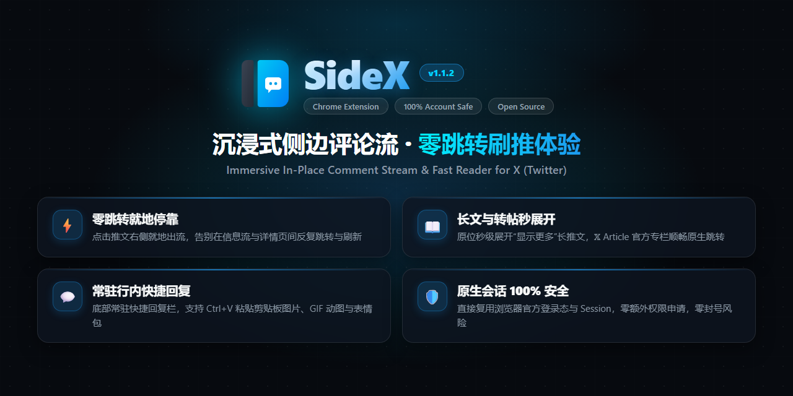

<div align="center">
  <a href="https://github.com/UncleK/SideX">
    
  </a>

  <p>
    <a href="README.md">🇺🇸 English</a> •
    <a href="#-特性功能">特性功能</a> •
    <a href="#-安装使用">安装使用</a> •
    <a href="#-快捷键">快捷键</a> •
    <a href="#-开源协议">开源协议</a>
  </p>

  <p>
    <a href="https://chromewebstore.google.com/detail/ccbkagemmobenjoioicemekhjbggmpde">
      
    </a>
    
    
    
    
  </p>

  <br />
  <a href="demo/demo.mp4">
    
  </a>
  <p><em>🎬 点击动图可查看高清视频演示 (<a href="demo/demo.mp4">demo.mp4 · 947KB</a>)</em></p>
  <br />
</div>

---

## 📖 项目简介

**SideX** 彻底重构了 X (Twitter) 网页端的浏览体验——**点击推文即可在右侧自动加载评论流，主帖长文原位自动展开**，无需跳页、不丢失时间线滚动位置，带来丝滑顺畅的沉浸式“边刷边看”体验。

---

## ✨ 特性功能

* 🚀 **右侧就地停靠**：在推文流中直接点击任意推文，评论流秒级停靠在页面第三列，零跳转、不重新加载页面。
* 📖 **长文原位展开**：自动展开主帖“显示更多（Show more）”，原地阅读完整长文。
* 🧵 **树状对话流 & 子评论下钻**：智能重构评论层级与清晰连接线，支持自定义二级回复默认展示数（1/2/3/5），原位平滑展开零跳回顶部。自动展示已加载的作者连续自回复；也可开启回复长正文自动展开，该选项默认关闭。
* 📚 **评论持续加载**：同时显示已加载的一级回复数和 X 报告的总数。滚动到底部自动加载默认开启，可在设置中关闭；嵌套分支保留各自的续载入口，X 折叠的回复需要主动展开。
* 📌 **可选固定面板**：固定后，点击外部、按 Esc 和 X 站内导航会保留面板，并高亮对应帖子；仍可切帖或手动关闭。自动固定默认关闭，仅影响新打开的面板。
* 💬 **快捷回复与官方弹窗**：快捷栏固定为紧凑样式，保留图片、GIF、投票、表情、定时、位置和内容披露（旗帜）7 个入口。文字、表情和最多 4 张 JPG/PNG/WebP 可快捷发送；高级工具在当前页打开 X 官方弹层。选择“官方弹窗”后，点击评论下方的回复图标直接打开官方回复框，不新开浏览器窗口。
* ✍️ **多条文字草稿**：按帖子和回复对象分别暂存未发送的文字，切回时恢复。切帖和关闭评论区直接响应，不弹出拦截提示。草稿仅在当前标签页保留，刷新页面或关闭标签页后清空；关闭或切换回复后不恢复图片附件。
* 🔄 **官方交互优先**：引用在当前页面打开 X 官方编辑器并显示原帖卡片；分享复用官方菜单，选项随账号权限和媒体类型变化，也支持主页面未渲染的评论。同一帖子已在页面原生渲染时，优先使用官方点赞、收藏并同步状态；其余评论通过 X 会话请求处理。
* 🌐 **可选翻译方式**：默认使用 X 官方翻译；可在扩展设置中选择 Google，或隐藏 SideX 翻译按钮，使用已有翻译插件的划词/网页翻译。
* 👤 **用户悬浮卡**：页面存在对应原生用户入口时，保留官方卡片及其交互，并在侧栏旁显示；其余情况使用包含简介、关注关系和共同关注的后备卡片。
* 🎨 **主题自适应 & 自由拉伸**：完美自适应浅色（Light）、暗色（Dim）与黑色（Dark）主题；可随意拖拽右边缘调节抽屉宽度。
* 🛡️ **浏览器内运行**：复用当前 X 会话，无 SideX 中转服务器；选用 Google 翻译时，正文直接发送给 Google。

---

## 📦 安装使用

适用于 Chrome、Edge、Brave、Arc 等所有 Chromium 浏览器：

### 方式一：Chrome 官方应用商店一键安装（强烈推荐）
👉 **[点击直达 Chrome Web Store 官方商店](https://chromewebstore.google.com/detail/ccbkagemmobenjoioicemekhjbggmpde)**，一键添加至浏览器并享受自动更新！

### 方式二：下载 ZIP 压缩包（离线直装，100% 成功）
1. 前往 [Releases 页面](https://github.com/UncleK/SideX/releases) 下载最新发布的 **`SideX-v*.zip`** 并解压。
2. 打开 `chrome://extensions/`（或 `edge://extensions/`），开启右上角**「开发者模式」**。
3. 点击左上角**「加载已解压的扩展程序」**（Load unpacked），选择解压后的文件夹即可。

### 方式三：通过 Git 源码安装（开发者）
```bash
git clone https://github.com/UncleK/SideX.git
```
在扩展管理页面点击「加载未打包的扩展程序」，选择克隆的 `SideX` 文件夹即可。

5. 打开 [x.com](https://x.com) 或 [twitter.com](https://twitter.com)，点击任意推文即可享受就地展开的评论流！

---

## ⌨️ 快捷键

| 操作 / 快捷键 | 功能说明 |
| :--- | :--- |
| **单击推文正文或空白处** | 原地打开或切换评论，分别保留文字草稿 |
| **ESC** | 关闭当前浮层或未固定的评论抽屉 |
| **单击侧栏外空白处** | 关闭未固定的评论抽屉并保留文字草稿 |
| **固定按钮** | 切换外部点击、Esc 和站内导航是否保留面板 |
| **侧栏关闭按钮** | 关闭抽屉并保留文字草稿 |
| **拖拽右边缘** | 自由拉伸调节侧边栏宽度（自动记忆） |
| **双击右边缘把手** | 恢复默认宽度（与原生第三列等宽） |
| **Ctrl + V** | 在评论输入框中直接粘贴剪贴板图片 |
| **Ctrl + Enter** | 快速提交并发送评论 |

---

## ⚠️ 免责声明

SideX 是一款完全开源、用于提升个人阅读效率的第三方辅助工具，**与 X Corp. / Twitter 官方无任何隶属或背书关系**。

---

## 开发与验证

扩展直接加载已提交的源码及 `vendor/twitter-text.js`，日常修改不需要构建。更新字数库时运行 `npm run build:text`，会一并生成第三方许可说明。修改后在 `chrome://extensions` 重新加载 SideX，再刷新 X 页面。

```bash
npm ci --ignore-scripts
npm test
```

回归检查使用合成 X 响应和 DOM，覆盖新旧用户资料结构、官方翻译请求、Google 长文分段、原生按钮复用、失败回滚、翻译/展开状态保留、切帖滚动重置和过期请求隔离。测试不会对真实 X 账号执行操作。

1.1.25 整合 maxDNA 的 [PR #5](https://github.com/UncleK/SideX/pull/5)，修复切入某条回复再返回原帖后，先前浏览过的回复被移到前面的问题。按当前响应保留回复顺序，同时保留已加载的后代回复并去重，保持当前内容和可见性更新的优先级。组合代码通过 172 项本地回归，包含 1.1.24 的引用与分享用例。

1.1.24 修复引用与分享：引用在当前页面打开 X 官方编辑器并显示原帖卡片；分享复用 X 当前加载的官方菜单组件，选项跟随账号权限和帖子媒体类型，也支持主页面未渲染的评论。保留已有草稿；官方组件暂不可用时提示重试。

1.1.23 整合 [PR #2](https://github.com/UncleK/SideX/pull/2)、[PR #3](https://github.com/UncleK/SideX/pull/3) 和 [PR #4](https://github.com/UncleK/SideX/pull/4)，增加可选的面板固定与当前帖高亮、已加载／总回复计数、滚动到底部自动加载、作者串文展开和嵌套分支续载。自动固定和长正文自动展开默认关闭，自动加载默认开启，折叠回复需要主动展开。补充修复普通分页被 Spam 覆盖、导航和原生更新打断在途请求，以及缓存回复及其后续回复未同步可见性的问题。整合后的源码通过 162 项本地回归，保留 v1.1.22 的多条文字草稿行为。中英文弹窗布局与设置写回还通过了使用本地扩展 API 模拟的 Chromium 检查。

1.1.22 移除回复保护和切帖提示，按帖子和回复对象分别保留文字草稿。切帖、关闭抽屉、按 Esc 或点击外部会暂存文字，切回时恢复文字及原回复对象。草稿仅在当前标签页保留，刷新页面或关闭标签页后清空；图片附件不存入草稿，关闭或切换回复后清除。发送失败或结果未确认保留文字，确认发布后只清理对应草稿。已开始的发送请求继续防重，旧响应不会清除另一条回复，发送结束后按钮恢复普通文案。本次 85 项本地回归覆盖文字恢复、附件不恢复和迟到的上传结果等情况。

1.1.18 新增“图片评论区”设置，默认使用 SideX 样式；选择 SideX 后，仅替换官方图片查看器右侧的评论栏，保留图片、切图及原生折叠／展开。SideX 标题栏也提供折叠按钮；折叠后查看大图，展开后保留评论滚动位置与草稿。首页点击图片仍走官方查看器，点击正文或空白处仍在原页面打开评论栏。该设置与回复模式分别保存。官方回复模式不显示底部回复栏；快捷工具按 ESC 直接返回工具打开前的位置，包括保留下层图片查看器。

引用卡片正文默认最多显示 3 行，仅在超出时显示“展开引用”，可就地展开及再次收起。正文链接、引用图片和打开原帖的行为保留。图片评论区默认 SideX，明确保存的官方选择仍会保留。

此前修复保留：带图／视频评论的正文链接、主动提及和回复分支，以及支持重试、去重和过期分页隔离的“加载更多”。`tests/fixtures/google-source-comment.json` 保留触发源码链接丢失问题的公开响应字段。

两种模式保留原有设置值。快捷栏不再被完整官方编辑器替换，避免工具面板往返时样式跳变。官方编辑器和选择面板保持在 X 原有节点树里；SideX 将官方弹层容器提升到浏览器顶层，避免被评论栏遮住。旗帜入口使用 X 的内容披露面板，提供付费合作和 AI 内容选项。高级编辑、附件及发送由官方回复框继续处理；当前输入可转移到官方工具，确认发布后只清理对应文字草稿。SideX 不保存图片或官方工具选项草稿。原生路由不可用时保留当前编辑器并提示，官方回复可回退到当前标签页的入口。

新增回归覆盖回复草稿隔离、重复发送、真实回复 ID、发布状态未确认时保留草稿、原生组件事件与还原，以及官方字数库的 URL 和 emoji 规则。验证不替用户发布真实回复。

X 的接口和组件结构会变化；已有翻译插件的兼容性取决于具体插件。缺少对应原生用户入口时，SideX 使用后备资料卡，提供“查看完整资料”链接，不模拟官方 Grok 的 Profile Summary 按钮。缺少原生节点的评论仍由 SideX 渲染。

## 📄 开源协议

基于 [MIT License](LICENSE) 开源发布。
